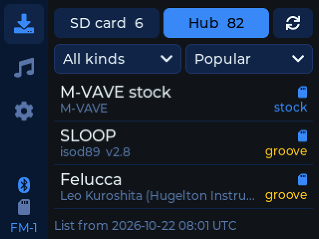
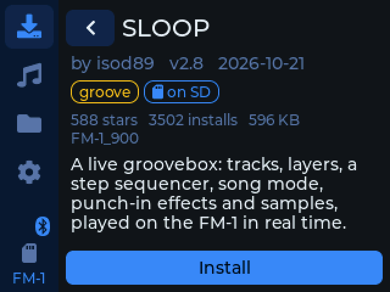
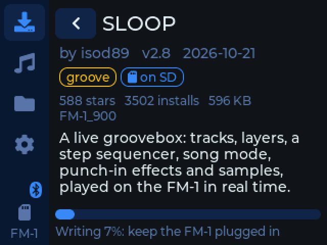
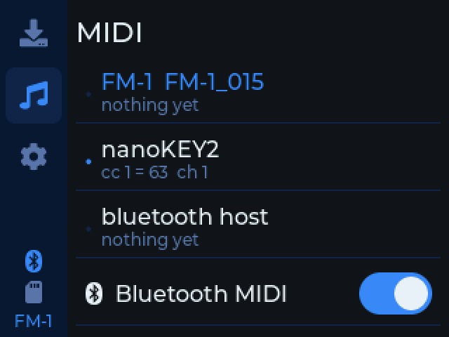
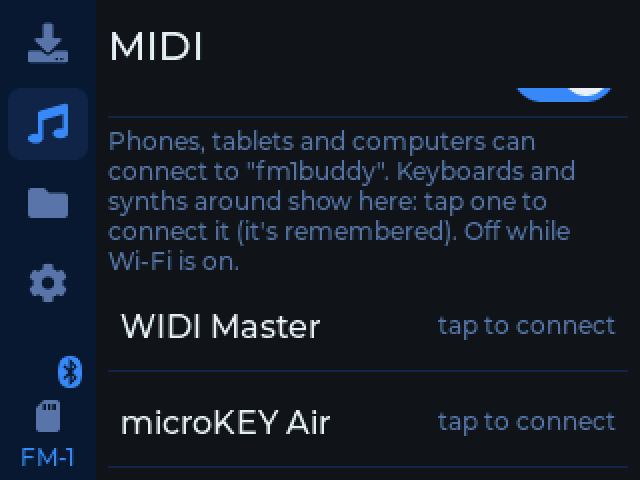
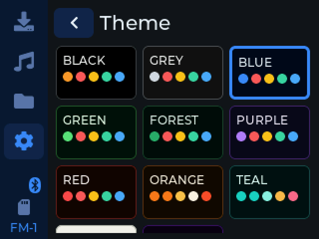

# fm1buddy

Switch the M-VAVE FM-1's firmware and play it from cheap USB and Bluetooth MIDI controllers, with no computer. It runs
on a ready-made [Freenove ESP32-S3 2.8" touch screen](https://store.freenove.com/products/fnk0104?variant=45040270213318)
(FNK0104B): firmwares from its SD card or the [FM-1 Firmware Hub](https://thefirmwarehub.com) over Wi-Fi, installed
on the FM-1 through a USB hub, with up to 4 USB MIDI devices and Bluetooth MIDI playing each other.

**Install it, and how to set it up:** <https://konsumer.github.io/fm1buddy/>

<table>
  <tr>
    <td></td>
    <td></td>
    <td></td>
  </tr>
  <tr>
    <td></td>
    <td></td>
    <td></td>
  </tr>
</table>

## Development

With [PlatformIO](https://platformio.org), the board on the computer (it's a USB serial port there; on a hub, the USB
host):

```sh
pio run -e cyd-s3 -t upload
```

The app also runs on the desktop (SDL2: `brew install sdl2`), with pretend Wi-Fi, an FM-1 and a keyboard. It runs
headless from a script too, for screenshots:

```sh
pio run -e sim && .pio/build/sim/program --fm1 --keys
.pio/build/sim/program --headless --script "tap 24 116; wait 300; shot settings.bmp; quit"
```

`tools/s3.py` (with `~/.platformio/penv/bin/python`) does the same on the board: `shot FILE`, `tap X Y`, `log` (what it
logged on the hub, also in `fm1buddy/log.txt` on its SD card), and `host` (the USB host for 20 s).

```
src/app/   the app (LVGL 9): pages, the Hub's list, MIDI between devices, the FM-1's update protocol; hal.h is what it
           needs from the board
src/s3/    the board: screen, touch, SD, Wi-Fi, USB host (TinyUSB), Bluetooth MIDI (NimBLE)
src/sim/   the simulator
site/      the installer page (GitHub Pages, with the latest release)
case/      the 3D-printed case (OpenSCAD); tools/cases.sh makes its STLs
```

## License

GPL-3.0-only. Credits and third-party parts: [LICENSING.md](LICENSING.md).
