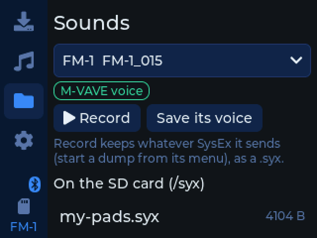
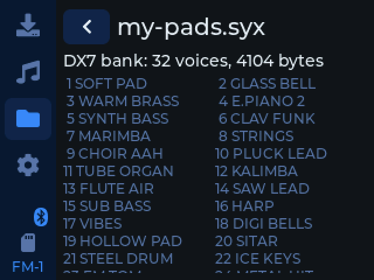
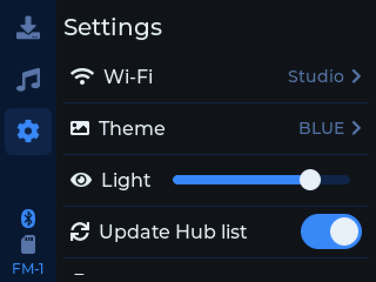

# fm1buddy

Switch the M-VAVE FM-1's firmware and play it from cheap USB and Bluetooth MIDI controllers, with no computer. It runs
on a ready-made [Freenove ESP32-S3 2.8" touch screen](https://store.freenove.com/products/fnk0104?variant=45040270213318)
(FNK0104B): firmwares from its SD card or the [FM-1 Firmware Hub](https://thefirmwarehub.com) over Wi-Fi, installed
on the FM-1 through a USB hub, with up to 4 USB MIDI devices and Bluetooth MIDI playing each other. Sounds (.syx) go
between the FM-1 and the SD card too, and so do
[fomajam](https://github.com/konsumer/fomajam)'s songs and its kits (drum machines of your own, from folders of
.wav files): keep one setup per song, and load it before you play. A setup's patterns also export as MIDI files, and its
kits as .wav files, for other gear.

It also backs up all of the FM-1's flash to its SD card (Settings, Back up the FM-1): the firmware, and what the
firmwares keep on it. It sends the FM-1 into the boot loader in its chip and reads it there, as
[FM-1-transporter](https://github.com/kurogedelic/FM-1-transporter) does (but over the USB cable, from stock V15 or a
firmware like fomajam, with no wiring), with JieLi's loader from [jl-uboot-tool](https://github.com/kagaimiq/jl-uboot-tool)
(downloaded the first time). It only reads: nothing on the FM-1 changes.

**MIDI routing** (on the MIDI tab, and on from power-up if you like) has the devices play each other, Bluetooth MIDI's
too. Wi-Fi stays connected once it's joined; only Bluetooth MIDI can't run with it (they don't both fit), so one pauses
while the other is on.

To copy files to and from the SD card without taking it out, Settings has **USB disk**: fm1buddy restarts as a USB
drive for a computer (plugged in instead of the hub), and nothing on it touches the card until you eject it on the
computer and tap Done, which restarts it as it was.

**Install it, and how to set it up:** <https://konsumer.github.io/fm1buddy/>

<table>
  <tr>
    <td></td>
    <td></td>
    <td></td>
  </tr>
  <tr>
    <td></td>
    <td></td>
    <td></td>
  </tr>
  <tr>
    <td></td>
    <td></td>
    <td></td>
  </tr>
</table>

## Development

With [PlatformIO](https://platformio.org), the board on the computer (it's a USB serial port there; on a hub, the USB
host):

```sh
pio run -e cyd-s3 -t upload
```

The app also runs on the desktop (SDL2: `brew install sdl2`), with pretend Wi-Fi, an FM-1 and a keyboard. It runs
headless from a script too, for screenshots:

```sh
pio run -e sim && .pio/build/sim/program --fm1 --keys
.pio/build/sim/program --headless --script "tap 24 142; wait 300; shot settings.bmp; quit"
```

`tools/install-test.sh` installs a package on the pretend FM-1, cleanly and with faults (lost and repeated requests,
garbled answers, unplugged while writing), and checks it ends up exactly as the package.

Each install on the board writes what went between it and the FM-1 to `fm1buddy/installs/N.txt` on the SD card (the
last 10 are kept): send one along with a report of an install gone wrong.

`tools/s3.py` (with `~/.platformio/penv/bin/python`) does the same on the board: `shot FILE`, `tap X Y`, `log` (what it
logged on the hub, also in `fm1buddy/log.txt` on its SD card), and `host` (the USB host for 20 s).

```
src/app/   the app (LVGL 9): pages, the Hub's list, MIDI between devices, the FM-1's update protocol, sounds (SysEx),
           setups and fomajam's kits and MIDI files (sounds, kits, songmidi), backups (uboot);
           hal.h is what it needs from the board
src/s3/    the board: screen, touch, SD, Wi-Fi, USB host (TinyUSB), Bluetooth MIDI (NimBLE)
src/sim/   the simulator
site/      the installer page (GitHub Pages, with the latest release)
case/      the 3D-printed case (OpenSCAD); tools/cases.sh makes its STLs
```

## License

GPL-3.0-only. Credits and third-party parts: [LICENSING.md](LICENSING.md).
